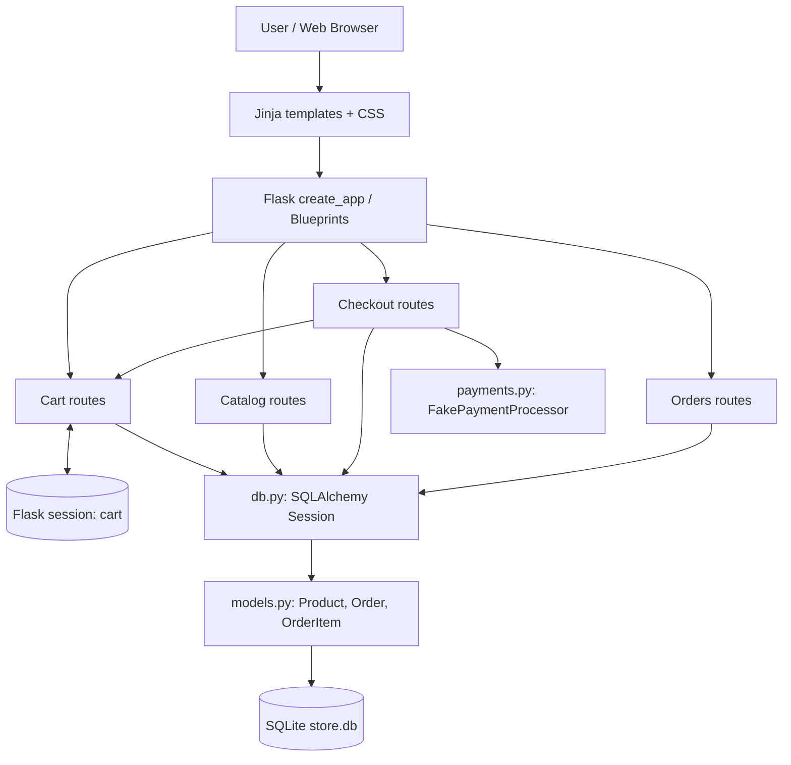

# Milestone 1 — Understand & Establish the Baseline

> **Understand before you redesign.**

## 1. Team & Store

- **Team members: Vero Hinojosa, Nathalie Marin, Andrés Olvera, Oswaldo Oseguera and Braulio Milanés**
- **Store name: BANVO**
- **Store vertical / concept: Electronic products and technologic accesories ecommerce**
- **Repository: https://github.com/Vick-1973/commerce-evolution-starter-marin-hinojosa-oseguera-olvera-milanes**
- **Short product description: BANVO offers technology products for study, work, and entertainment: laptops, headphones, keyboards, monitors, smartwatches, and accessories. In M1, texts, catalogs, illustrations, and styles are customized without changing the starter's purchase logic.**

## 2. Baseline Validation

**Required: perform these checks on the ORIGINAL starter before merging the BANVO customization.**

| Validation check | Team status | Required evidence |
| --- | --- | --- |
| Application starts after a clean setup (`python seed.py`, `flask --app store run --debug`) | Pending | Original storefront screenshot and Flask terminal |
| Automated tests (`python -m pytest`) | Pending | Screenshot showing the actual pytest totals |
| GitHub Actions on the team's repository | Pending | Green workflow run with commit and date |
| Catalog → product detail → cart → checkout → confirmation → order history | Pending | Evidence of an actual completed purchase |
| `products`, `orders`, `order_items`, and `stock_quantity` persist after server restart | Pending | SQLite evidence and order-history screenshot |
| Declined payment using `tok_fail` creates no order and does not reduce inventory | Pending | Application result and before/after database comparison |
| Tests and CI still pass after BANVO customization | Pending | Final screenshots/logs |

**Local setup commands (PowerShell, from the repository root):**

```powershell
py -m venv .venv
.\.venv\Scripts\Activate.ps1
python -m pip install --upgrade pip
python -m pip install -e ".[dev]"
python seed.py
python -m pytest
flask --app store run --debug
```

**Manual purchase validation:** Add a product to the cart, fill in the checkout form, use `tok_success`, and verify order confirmation and history. Record the order ID and stock before/after. Stop and restart Flask and confirm the order and inventory remain persisted. In a clean/controlled test case, try `tok_fail` and verify there is no new order or stock decrease. Note that `reset_db.py` **deletes the development database**; collect baseline evidence first.
## 3. Current System Design

This diagram describes the **existing starter system**. BANVO branding introduces no new architecture layers or changes to the purchase flow.



**Important:** The cart is stored in the Flask session, not in its own SQLite table. Orders, order items, and product inventory are stored in SQLite..

## 4. Responsibilities & Dependencies

| Existing module | Main responsibility | Important dependencies |
| --- | --- | --- |
| `src/store/__init__.py` | Initializes Flask, database, blueprints, store name, and money filter. | Flask, `db.init_app`, four blueprints. |
| `src/store/routes/catalog.py` | Queries and displays active products and product details. | `Product`, `get_session`, Jinja. |
| `src/store/routes/cart.py` | Stores cart quantities in the session and builds cart line items. | Flask session, `Product`, SQLAlchemy. |
| `src/store/routes/checkout.py` | Validates customer input and stock; computes shipping and total; handles simulated payment; creates orders and decreases stock. | `get_cart_lines`, `FakePaymentProcessor`, `Order`, `OrderItem`, `get_session`. |
| `src/store/routes/orders.py` | Lists past orders and displays order details/confirmation. | `Order`, SQLAlchemy, Jinja. |
| `src/store/payments.py` | Simulates approved/declined payments and returns a reference. | `PaymentDeclined`, UUID. |
| `src/store/models.py` | Defines the `Product`, `Order`, and `OrderItem` ORM mappings. | SQLAlchemy ORM. |
| `src/store/db.py` | Configures the database engine, sessions, and tables. | SQLite/SQLAlchemy, Flask app context. |
| `src/store/templates/` and `static/` | Browser presentation and forms. | Flask/Jinja, CSS, product images. |
| `seed.py` | Loads a sample catalog if the product table is empty. | `create_app`, `Product`, SQLAlchemy. |

### Existing purchase flow

1. The browser requests the catalog; `catalog.py` queries products with `active == 1` through SQLAlchemy.
2. Adding an item updates cart quantities in the Flask session. `cart.py` reads the relevant products from the database to display line items and subtotals.
3. Checkout reads the cart through `get_cart_lines(db)`, validates the form, and checks each requested quantity against `stock_quantity`.
4. Checkout computes a subtotal plus a fixed standard shipping amount of **9,900 cents**, then calls `FakePaymentProcessor().charge(total, payment_token)`.
5. For `tok_fail`, the simulated payment is declined and no order is created. For an approved payment, checkout creates an `Order`, calls `db.flush()`, creates `OrderItem` records, and reduces product stock.
6. `db.commit()` persists the changes. The session cart is cleared, and the user is redirected to order confirmation. `orders.py` reads the saved orders from SQLite, including after an application restart.


## 5. Design Observations

. **Strength — responsibilities are localized by user interaction.** Four blueprints (`catalog`, `cart`, `checkout`, `orders`) separate the main routes. This division is understandable and appropriate for the starter's scope.
2. **Strength — historical order details are preserved.** `OrderItem` stores the SKU, product name, unit price, and quantity at purchase time in addition to its relationship with `Product`. A past order can still show its original details if the catalog changes.
3. **Reasonable original decision — deliberate simplicity.** A session-based cart, local SQLite database, fixed shipping amount, and `FakePaymentProcessor` keep the demonstration small and testable without external services.
4. **Design pressure — checkout owns several coordination rules.** `routes/checkout.py` handles forms, inventory validation, shipping calculation, concrete payment invocation, order creation, stock changes, and commit. This is manageable today, but future shipping, discount, or payment rules could increase coupling.
5. **Potential technical debt — evolving persistence and payment.** `db.py` creates tables using `Base.metadata.create_all`, and development reset/seed scripts replace demo data instead of performing schema migrations. This is reasonable for the baseline. A real payment provider would also require reviewing consistency because simulated charging occurs before `db.commit()`.

## 6. AI Use

If the team used AI meaningfully, list:

- **Tool:** ChatGPT (OpenAI).
- **Declared assistance:** Understanding the assignment and seeing if what was planned was gouing to work correctly.
- **Required human review:** Analized the propositions and impleeted what was good to the scope and what was not was conssidered for possible future implementations.

If no AI was used, state that explicitly.
