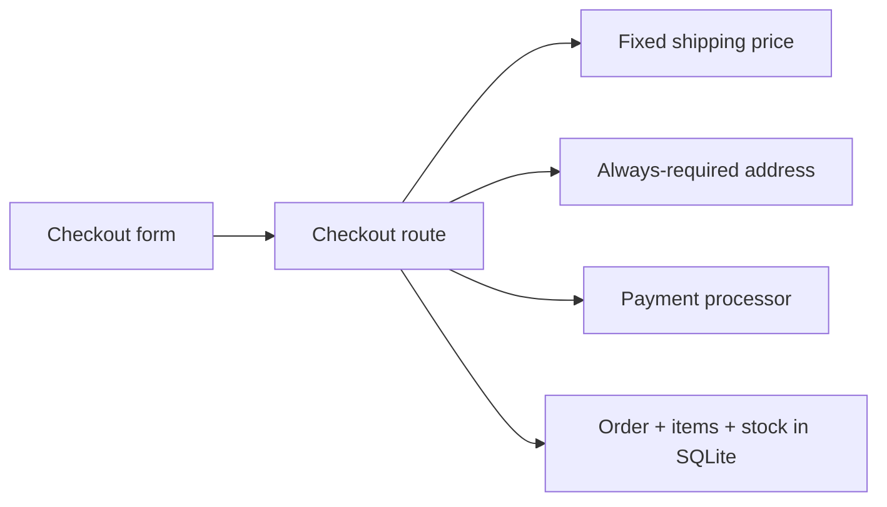
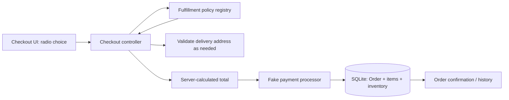

# BANVO — Milestone 2: Fulfillment Options

**Project:** BANVO — Electronics E-commerce
**Public team repository:** https://github.com/Vick-1973/commerce-evolution-starter-marin-hinojosa-oseguera-olvera-milanes
**Team members:** VERONICA PAOLA HINOJOSA FERADO, NATHALIE MARIN LOPEZ, BRAULIO MILANES LOZA, OSWALDO OSEGUERA SANDOVAL, ANDRES ALFONSO OLVERA GONZALEZ
**Status:** Locally implemented and tested; GitHub Actions/PR evidence must be captured after the team pushes the changes.

## 1. Change Request

At checkout the customer can choose **Standard Shipping (MXN $99)**, **Express Shipping (MXN $199)**, or **Store Pickup (MXN $0)**. Shipping requires an address; pickup does not. The selected option, its charged fee, order items, total, payment reference, and inventory changes must be persisted as part of the existing purchase flow. The solution should support new fulfillment options without scattered edits.

## 2. Before: actual M1 design and pressure

The original `src/store/routes/checkout.py` contained a single constant:

```python
STANDARD_SHIPPING_CENTS = 9_900
```

The GET view displayed a fixed fee, while the POST view always required `shipping_address` and calculated `subtotal + STANDARD_SHIPPING_CENTS`. `Order` had `shipping_cents` but **no fulfillment method**, and confirmation hard-coded "Standard shipping." This worked for M1, but with three methods, changing policy in multiple places would cause duplicated conditional logic and inconsistent amounts.



## 3. After: the implemented design

We chose a **data-driven fulfillment policy**, not a formal GoF Strategy hierarchy. All three current methods vary along just two data points: a fixed fee and whether an address is required. `src/store/fulfillment.py` therefore owns a small immutable `FulfillmentOption` record and a registry containing the supported options. The checkout controller asks that registry for the selected option and remains responsible for orchestration.



**Responsibilities and dependencies**

| Unit | Responsibility |
| --- | --- |
| `fulfillment.py` | Codes, display names, fees, and address requirements; returns only registered options. |
| `routes/checkout.py` | Validate input and stock, calculate total using selected policy, charge, persist order/items, decrement inventory, clear cart on success. |
| `models.py`, `db.py` | Store `fulfillment_method` with order; upgrade pre-existing SQLite orders without dropping their data. |
| `templates/checkout.html`, `static/css/banvo.css` | Display options, show/hide address, preview totals; final amounts are not trusted from browser. |
| `routes/orders.py`, order templates | Display persisted fulfillment choice and charged fee. |
| `payments.py` | Unchanged fake processor; receives server-calculated total. |

## 4. Persistence and backward compatibility

`orders.fulfillment_method` is a non-null string with default `standard_shipping`. When the application opens an existing M1 SQLite database that lacks the column, `init_app` adds it with `ALTER TABLE ... NOT NULL DEFAULT 'standard_shipping'`. Old orders keep their IDs, line items, charged shipping, and totals, and are interpreted as Standard Shipping. Calling `create_app()` multiple times does not repeat the migration.

For Store Pickup, the existing non-null `shipping_address` is stored as an **empty string**; this avoids widening the schema with a nullable column solely to represent "not applicable." The backend ignores any address submitted for pickup. The selected method code and historical `shipping_cents` are stored; if prices change later, existing orders do not get repriced.

## 5. Decision and trade-offs

**Why a small registry now?**

- Higher cohesion: only one module knows option fees and address rules.
- Lower accidental coupling: route and template use stable policy data, rather than duplicating prices and `if/elif` branches.
- Easy addition of another *fixed-fee* method: append a new `FulfillmentOption` to `OPTIONS`, without rewriting checkout.
- No unnecessary interfaces, factory, subclasses, or dependency injection for three data-only choices.

**Costs / limits:** the registry is in code rather than database-configurable; shipping fees are fixed rather than weight-, destination-, or provider-dependent; one SQLite-specific migration is managed manually. If independent algorithms emerge (carrier API, geographic zones, dynamic fees), a Strategy-like collaboration may then remove more complexity than it adds. For now it would introduce ceremony without benefit.

**The observed change is a feature, not just a refactor.** The behavior intentionally changes; tests protect the older behavior and cover the added paths.

## 6. Behavior, tests, and safety net

Existing cart, catalog, order history, payment tokens, item snapshots, and inventory updates remain in place. `pytest` covers these integration scenarios:

- All three methods persist the correct option and fee: 9,900 / 19,900 / 0 cents.
- Shipping without an address is rejected; pickup without an address is accepted.
- Unknown method codes are rejected; submitted shipping prices cannot override server rules.
- Declined payments leave orders, stock, and cart unchanged.
- Legacy POSTs without the new field retain Standard Shipping.
- Historical M1 database orders survive the additive migration.
- Checkout displays all three methods; confirmation and history display the persisted choice.

**Local verification:** `python -m pytest -v` — [insert the final terminal output / screenshot].
**GitHub Actions:** [insert a green run URL / screenshot for the final PR or main branch; local runs are not GitHub CI evidence].


## 7. Course connections

- **08 — Cohesion, Coupling & Information Hiding:** the shipping policy owns related data and hides volatile fee/requirement decisions from checkout.
- **11 — Code Smells:** a smell is a symptom; here the concrete incoming requirement exposed duplicated-change risk rather than a speculative problem.
- **12 — Refactoring Techniques:** changes are small and tested; a feature intentionally changes observable behavior, whereas pure refactoring does not.
- **13 — Testing Testability:** unit-style policy tests and Flask/SQLite integration tests provide focused and end-to-end evidence.
- **15 — Introduction to Design Patterns:** discuss context, forces, structure, and consequences before choosing a named pattern.
- **16 — Strategy:** consider interchangeable algorithms when behavior *actually varies*; fixed fees and a boolean do not yet warrant distinct strategy implementations.
- **20 — Patterns in Practice:** classify patterns by the pressure they remove; Python can express variability without textbook class hierarchies.

## 8. Meaningful AI use
ChatGPT (OpenAI) was used to help with the automated test to ensure everything was working correctly; everything was done using the course’s presentations as guidance.