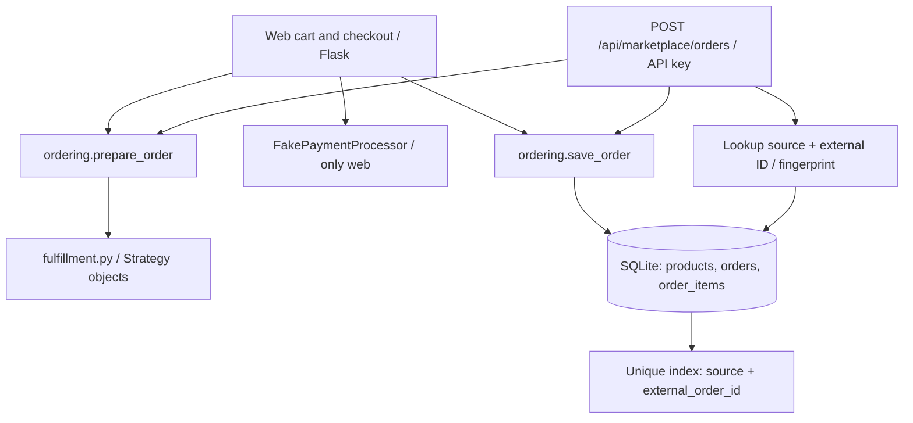

# BANVO — Milestone 3: Marketplace Integration and Shared Ordering

**Store:** BANVO — Electronics E-commerce
**Team repository (from project documentation; verify current URL):** https://github.com/Vick-1973/commerce-evolution-starter-marin-hinojosa-oseguera-olvera-milanes
**Members (from M2 documentation):** Veronica Paola Hinojosa Ferado; Nathalie Marin Lopez; Braulio Milanes Loza; Oswaldo Oseguera Sandoval; Andres Alfonso Olvera Gonzalez.

## 1. Change request

BANVO now accepts orders both from the existing web storefront and from a trusted marketplace API. A marketplace sends its external order ID, buyer, shipping method/address, and SKUs/quantities; it has **already charged the buyer**. BANVO must not invoke `FakePaymentProcessor` for marketplace ingestion. Both origins must create the same `Order`, `OrderItem` snapshots, fulfillment charges and inventory decrements. Retries must be idempotent.

The M2 fulfillment policy also evolves into actual **Strategy** collaboration in the **first M3 commit** to make variable delivery/pickup behavior replaceable.

## 2. Before / design pressure

Prior to M3:

- `routes/checkout.py` coordinated Flask form, session cart, payment, inventory checking, order persistence and stock decrement.
- Only web checkout could create an order. Copying the entire controller into a marketplace route would duplicate pricing, fulfillment, stock and order-item logic.
- `orders` had no origin, external reference or database-enforced idempotency key.
- M2 had a simple data registry of fees and `requires_address` flags, which addressed fixed options but did not delegate algorithm-specific rules.

## 3. After / current component view



**Dependency direction:** both entry points depend inward on the same `ordering` operations; `ordering` depends on the domain models and fulfillment contract, **not** on Flask routes, browser sessions or the payment processor. The API boundary translates marketplace JSON into `RequestedItem` values. The web boundary translates session cart lines and invokes the fake processor **before** asking the shared core to persist the order. There is no direct dependency between the two entry points.

### Component responsibilities

| Component | Responsibility |
| --- | --- |
| `fulfillment.py` | Strategy protocol; flat-rate delivery and store-pickup implementations; option registry and address behavior. |
| `ordering.py` | Shared item validation, authoritative SKU pricing, fulfillment quote, conditional stock updates, order + item persistence in one transaction. |
| `routes/checkout.py` | Web form/session adapter, web-only fake payment, redirect/flash behavior. |
| `routes/marketplace.py` | Authenticated JSON adapter, external request validation, idempotency lookup and response semantics; **no payment calls**. |
| `models.py`, `db.py` | Persist source, external ID and request fingerprint; additive SQLite migrations; unique external index. |
| `routes/orders.py`, templates | Existing order history and confirmation, with optional marketplace provenance displayed. |

## 4. Strategy implementation (first commit)

The `FulfillmentStrategy` contract offers `calculate_fee(subtotal_cents)` and `normalize_address(address)`, with a `requires_address` property. `FlatRateDeliveryStrategy` applies the two shipping fees and requires a nonblank address. `StorePickupStrategy` returns zero fee and removes any irrelevant shipping address. `FulfillmentOption` composes the strategy and keeps a small registry for selecting it by code.

**Why Strategy now?** Future delivery, pickup, geographic or carrier behavior may vary independently from the checkout itself; callers use the same interface even if an algorithm changes. Compared with M2's record-only solution, this adds a small amount of indirection but localizes address and fee behavior. The HTML price preview still assumes present-day fixed fees; a future destination-dependent strategy would need a server-backed quote endpoint, not just a new class.

## 5. API integration contract

**Endpoint:** `POST /api/marketplace/orders`
**Header:** `X-Marketplace-Key: <configured secret>`
**Content-Type:** `application/json`

```json
{
  "external_order_id": "MP-2026-1001",
  "buyer": {"name": "Alex Buyer", "email": "alex@example.com"},
  "shipping": {"method": "store_pickup", "address": ""},
  "items": [{"sku": "BNV-MOU-002", "quantity": 1}]
}
```

- **201 Created:** new `order_id`, `external_order_id`, `source`, method, server-calculated subtotal and fee, `replayed: false`.
- **200 OK:** matching retry with same external order ID and normalized business data, `replayed: true`; no new order or stock changes.
- **409 Conflict:** same external ID with different details, or inadequate inventory; neither case creates a new order.
- **400 Bad Request:** invalid JSON object fields, quantities, method or required shipping address.
- **401 Unauthorized / 503 Not Configured:** invalid integration secret or no secret configured.
- **404 Not Found:** unavailable SKU. **415 Unsupported Media Type:** not JSON.

The marketplace request cannot choose local prices or call the payment processor. `FakePaymentProcessor` is used only by storefront checkout. A generated local `marketplace_paid_...` reference is recorded as an audit marker for the marketplace's already-completed external payment; **it is not a second payment**.

## 6. Persistence, migration and idempotency

`orders` gains:

- `source` — non-null `storefront` default, or `marketplace`.
- `external_order_id` — nullable string (normal web purchases keep `NULL`).
- `external_payload_hash` — SHA-256 of normalized buyer/shipping/SKU/quantity details to detect conflicting replays.
- `uq_orders_source_external` — **unique SQLite index on (`source`, `external_order_id`)**. SQLite permits repeated `NULL` external IDs for storefront orders.

Application startup adds missing columns and the index to a preexisting M1/M2 database; existing orders keep their original IDs, items, totals and payment references, with `source = 'storefront'`. The migration is repeatable, and does **not** require `reset_db.py`.

New and repeated marketplace requests are checked in the API adapter. Crucially, the database unique index prevents double insertion under concurrent requests; an `IntegrityError` rolls back the full transaction, after which the API returns the previously saved order if the fingerprint matches. Each SKU decrement uses an SQL conditional `UPDATE ... WHERE stock_quantity >= quantity`; all stock adjustments and order snapshots commit together or roll back together.

## 7. Duplicated knowledge removed / deliberately retained

**Removed:** item lookup and pricing, fulfillment validation, order-item snapshots, order persistence, inventory decrement and stock re-check are shared in `ordering.py`, rather than copied into marketplace and web routes.

**Deliberately retained at boundaries:** Flask web session/cart navigation, flash messages, browser form fields and `FakePaymentProcessor` stay with the web adapter. JSON parsing, integration-key checking, external ID and retry response codes stay with the marketplace adapter. Their differences are external protocol/payment semantics, not duplicated domain knowledge.

## 8. Trade-offs / remaining technical debt

- **Pros:** shared core is independently testable; marketplace can never accidentally charge the local processor; idempotency is enforced in persistent storage; new fixed or algorithmic fulfillment strategies can be composed without scattering checkout conditions.
- **Costs:** more modules and a Strategy protocol; a small hand-maintained SQLite migration instead of Alembic; flat-fee preview in JavaScript assumes known fees, so truly dynamic shipping would need another UI/API step.
- **Security:** a static shared secret is appropriate only for the teaching integration. Real vendor connectivity needs signed webhooks, secret rotation, authenticated provenance, transport hardening, replay timestamps, rate limits and observability.
- **Payment/inventory:** a web payment occurs before final DB commit; a rare post-payment stock race or DB failure needs a refund/compensation workflow in a production system. The marketplace's external paid status is trusted from the authenticated integration, not cryptographically verified with a real provider.
- **External order scope:** the unique index currently models one marketplace integration. More vendors would require a `marketplace_id` namespace alongside the external ID.
- **Atomicity:** SQLite conditional updates and the unique index protect single-DB consistency; high-concurrency deployments would need appropriate transaction isolation, retry/backoff and possibly a production RDBMS.

## 9. Verification and CI

- **Baseline extracted M2:** 27 tests passing.
- **After M3 (local verification):** `python -m pytest -v` — **63 passed** on the extracted project. Rerun on each student computer and confirm CI after PRs merge.
- `tests/test_strategy.py` checks interchangeable strategies and the address rules.
- `tests/test_marketplace.py` covers authenticated ingestion, all methods, no duplicate stock change, conflict detection, payment isolation, validation, migration, order visibility and a database unique constraint.
- `.github/workflows/tests.yml` already runs `pytest` on `push` and `pull_request`; **its successful remote execution must be verified after team commits are pushed.** A local passing test suite is not GitHub Actions evidence.

## 10. Course concepts and AI use

The design decisions use the supplied presentation material on **Cohesion, Coupling & Information Hiding (08)**, **Interfaces, Dependencies & Composition (09)**, **Testing & Testability (13)**, **Strategy (16)**, **Adapter & Facade (18)** and **Patterns in Practice (20)**. Strategy is justified by the variable fulfillment behavior; the marketplace route behaves as a focused **adapter** translating external request shapes, but no unnecessary class hierarchy was introduced. The shared ordering module presents a task-oriented, facade-like boundary without declaring a full architectural style.

AI support: ChatGPT assisted with source review to implement the new Strategy pattern, as well as helping with the creation of new tests to ensure everything was working correctly. Every detail proposed by the AI was deeply reviewed by the 5 team members.
